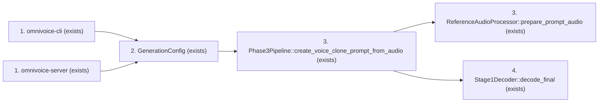

# Silence controls: output pad/fade and prompt trailing silence

**Approved**: 2026-11-16 - user: "approved, go ahead"

## Problem

Every generated clip gets 0.1 s of padding on each side and a 0.1 s linear fade-in and fade-out,
hard-coded at `crates/omnivoice-infer/src/stage1_decoder.rs:395, 450, 496` (and the
`decode_final_tensor_chunks` twin). A dubbing caller that asks for a line's exact length cannot
subtract padding it cannot set. The 0.1 s fade lands on the last consonant of lines that fill
their duration. The source guide measured this as "studen-" and fixed it with
`fade_duration=0.02` in the Python engine, which exposes both values. The Rust port does not.

With `preprocess_prompt=true` (the default), a reference that ends in silence has that silence cut
to 0.2 s twice: `split_on_silence` keeps 200 ms after the last chunk, then the edge trim keeps
200 ms (`audio_input.rs:90`). The guide's main glitch fix is to append 0.5 s of digital silence
to the reference. It took leading "g" bursts from 45/60 clips to 10/62. That fix cannot reach
the model through this engine. The only way around it today is `preprocess_prompt=false`, which
also skips the mid-silence removal and the punctuation fix.

When this ships, a library, CLI or server caller can set the output padding, the fade length and
an exact trailing silence on the reference. Callers who set nothing get byte-identical output.

## Shape

This reuses `fade_and_pad_audio` and `remove_silence` as they are. The decode and prompt paths
read three new `GenerationConfig` fields instead of literals. Every rule that changes an outcome
runs in `omnivoice-infer` as a pure function over samples plus config, so CPU unit tests reach it
without model weights. The CLI and server only parse and forward.

1. caller -> `omnivoice-cli` (exists) flags / `omnivoice-server` (exists) JSON or multipart fields - parse `pad_duration`, `fade_duration`, `prompt_trailing_silence` into `GenerationConfig`
2. `GenerationConfig` (exists) - holds the three fields. Its validation (new) rejects values that are out of range before any model work.
3. `Phase3Pipeline::create_voice_clone_prompt_from_audio` (exists) -> `ReferenceAudioProcessor::prepare_prompt_audio` (exists) - runs today's cleanup. Then, when `prompt_trailing_silence` is set, it strips trailing near-silence (-50 dBFS) and appends exact zeros before hop alignment.
4. `Stage1Decoder::decode_final` (exists) - output post-processing calls `fade_and_pad_audio(pad_duration, fade_duration)` from the config instead of `0.1, 0.1`.
5. out: WAV / HTTP audio. Reference-case and debug decode paths (parity harness) keep 0.1 / 0.1.

Out at step 5: the WAV or HTTP audio. An invalid config stops at step 2 (CLI exit 1, HTTP 422).

**Changes underneath**

| Front | What changes |
| --- | --- |
| domain | `GenerationConfig` gains `pad_duration: f32` (0.1), `fade_duration: f32` (0.1) and `prompt_trailing_silence: Option<f32>` (None) |
| public API | Downstream code that builds `GenerationConfig` with a struct literal stops compiling. The crate is bumped from `0.1.0-skylar-2` to `0.1.0-skylar-3` (door 1). `create_voice_clone_prompt_from_audio` / `prepare_prompt_audio` signatures may change to carry the new value; that is the builder's call, under the same bump. |
| stored data | nothing; artifact JSON (`artifacts.rs`) is untouched, so parity fixtures keep 0.1 / 0.1 |
| readers | `docs/generation-parameters.md` and `docs/cli-and-server.md` list the three new parameters with defaults and ranges |

Data: none - no stored entity is read or written.

## Surface

| Route | In | Out | Status | Who |
| --- | --- | --- | --- | --- |
| `POST /v1/audio/speech` (JSON and multipart) | new optional `pad_duration`, `fade_duration`, `prompt_trailing_silence` (numbers, seconds) | audio, unchanged shape | `200`; `422 invalid_request_error` when out of range or not a number; `401` without the key, as today | bearer-key holders, as today |

Command surface: `omnivoice-cli infer` and `infer-batch` gain `--pad-duration`, `--fade-duration` and
`--prompt-trailing-silence` (and their `_` aliases). They exit `0` on success and `1`, with a
message naming the flag, when a value is out of range. Local user only.

## Landing

| One-way door | Literal shape | Alternative rejected |
| --- | --- | --- |
| 1. Public `GenerationConfig` fields on a published crate | `pub pad_duration: f32`, `pub fade_duration: f32`, `pub prompt_trailing_silence: Option<f32>`; version `0.1.0-skylar-3` | `#[non_exhaustive]` and a separate options struct were both rejected by the user ("Add fields + bump") |
| 2. Server request field names, which clients bind to | `pad_duration`, `fade_duration`, `prompt_trailing_silence` in the request body | `trail_silence_ms` (milliseconds): the existing fields use seconds (`duration`, `audio_chunk_duration`) |

- Nothing else in this change is hard to reverse

## Criteria

### S1: Output padding and fade are set per request (P1)

A caller can request 0.02 s of fade and any padding from 0 to 2 s. Callers who set nothing get today's output.

**Acceptance Criteria**

1. The system SHALL default `GenerationConfig` to `pad_duration = 0.1`, `fade_duration = 0.1`, `prompt_trailing_silence = None`
2. WHEN final output post-processing runs with `pad_duration = p` THEN the system SHALL prepend and append exactly `floor(p * sample_rate)` zero samples
   - p = 0.25 at 24 000 Hz → 6 000 zeros each side; p = 0 → no added samples (length equals the faded clip)
3. WHEN final output post-processing runs with `fade_duration = f` THEN the system SHALL ramp the first and last `min(floor(f * sample_rate), len / 2)` samples linearly from 0 and to 0
   - f = 0.02 at 24 000 Hz on a 1 s constant clip → a 480-sample ramp at each end (linspace with endpoints, as upstream: samples 0..478 below 1, sample 479 at 1), samples 480..len-480 unchanged; f = 0 → every speech sample unchanged
4. WHILE all three fields hold their defaults the system SHALL produce final audio identical, sample for sample, to the previous hard-coded `0.1, 0.1` path, for both single and chunked decodes
5. The reference-case and debug decode paths (`decode_stage1_final_from_reference_case`, `debug_decode`) SHALL keep `0.1, 0.1` whatever the config holds
6. IF `pad_duration` is not finite, below 0 or above 2.0 THEN the system SHALL reject the config with `InvalidRequest` naming `pad_duration` before any model work
   - 2.0 → accepted; 2.0001 → rejected; -0.01 → rejected; NaN → rejected
7. IF `fade_duration` is not finite, below 0 or above 1.0 THEN the system SHALL reject the config with `InvalidRequest` naming `fade_duration`
   - 1.0 → accepted; 1.01 → rejected; infinity → rejected

### S2: The reference keeps an exact trailing silence (P1)

With `prompt_trailing_silence = 0.5` the model sees the reference followed by about 0.5 s of digital silence, whether or not preprocessing is on.

**Acceptance Criteria**

8. WHEN `prompt_trailing_silence = s` and `preprocess_prompt = true` THEN the prepared reference waveform SHALL end in a run of exact zeros whose length is between `round(s * sr) - (hop - 1)` and `round(s * sr)` samples, directly after the last sample above -50 dBFS
   - 1 s tone + 1 s zeros, s = 0.5, sr 24 000, hop 960 → zero run in [11 041, 12 000]; 1 s tone + 1 s of -60 dBFS noise → the noise is gone and the run is the same length
9. WHEN `prompt_trailing_silence = s` and `preprocess_prompt = false` THEN the system SHALL apply the same strip-and-append to the reference tail and change nothing else in the waveform
   - 1 s tone + 0.1 s zeros, s = 0.5 → the tone samples are identical to the `None` result and the tail run is in [11 041, 12 000]
10. WHILE `prompt_trailing_silence = None` the prepared reference waveform SHALL be identical to today's, with preprocessing on and off
11. WHEN `prompt_trailing_silence` is set THEN `ref_rms` and `ref_text` SHALL equal the values prepared with `None` for the same input
12. IF `prompt_trailing_silence` is set and the reference has no sample above -50 dBFS THEN the system SHALL return `InvalidRequest` saying the reference is empty after silence removal
    - all zeros, preprocess off, s = 0.5 → error; the same input with `None` and preprocess off → accepted, as today
13. IF `prompt_trailing_silence` is `Some(v)` with v not finite, below 0 or above 2.0 THEN the system SHALL reject the config with `InvalidRequest` naming `prompt_trailing_silence`
    - 0 → accepted (strip only, no zeros appended); 2.5 → rejected
14. WHEN a generation request carries `ref_audio` THEN the pipeline SHALL prepare its prompt with the request's `prompt_trailing_silence`. A request that already carries a `voice_clone_prompt` is used as given.

### S3: CLI and server expose the fields (P1)

**Acceptance Criteria**

15. WHEN a JSON speech request carries `"pad_duration": 0.05, "fade_duration": 0.02, "prompt_trailing_silence": 0.5` THEN the server SHALL hand the runtime a `GenerationConfig` holding those three values
16. WHEN a multipart speech request carries the same three fields as text THEN the server SHALL parse them as numbers and hand the runtime the same values
    - multipart `fade_duration=abc` → 422 `invalid_request_error` "fade_duration must be a number"
17. IF a speech request carries `pad_duration: 3` THEN the server SHALL answer 422 `invalid_request_error` with a message naming `pad_duration`, and SHALL NOT call the runtime
18. WHEN `infer` or `infer-batch` gets `--pad-duration 0.05 --fade-duration 0.02 --prompt-trailing-silence 0.5` (or the `_` aliases) THEN the CLI SHALL build a `GenerationConfig` holding those values
19. IF a CLI value is out of range (for example `--fade-duration 1.5`) THEN the CLI SHALL exit non-zero with a message naming the flag, before loading a model
20. WHEN `infer --help` or `infer-batch --help` runs THEN the help SHALL list the three flags with their defaults (`0.1`, `0.1`, `none`)
21. The docs (`docs/generation-parameters.md`, `docs/cli-and-server.md`) SHALL list the three parameters with default and range

## Out of scope

| Excluded | Why |
| --- | --- |
| Changing the defaults to 0.02 fade / 0.5 s trail | Parity with upstream Python stays the default; dubbing callers opt in |
| Configurable mid-silence removal on output (`remove_silence(500, 100, 100)`) | Not requested; the guide handles short clips with `atempo` on the caller side |
| Applying trailing silence to an already-built `voice_clone_prompt` | It is already tokenized; the caller controls the audio it was built from |
| Writing the fields into reference artifact JSON | The parity harness pins 0.1 / 0.1 (criterion 5) |
| End-to-end listening / burst-count measurement | No OmniVoice weights on this machine; the dubbing caller measures it |

## Assumptions

| Assumption | Chosen default | Rationale | Confirmed? |
| --- | --- | --- | --- |
| Trailing-silence knob semantics | Engine strips trailing near-silence and appends exact zeros (`prompt_trailing_silence: Option<f32>`, seconds) | User chose "Engine appends silence" | y |
| Knob with `preprocess_prompt=false` | Applies in both modes | User chose "Yes, always" | y |
| Public API compatibility | Plain pub fields, bump to `0.1.0-skylar-3` | User chose "Add fields + bump" | y |
| Bounds | pad and trail 0–2 s, fade 0–1 s, finite | User chose the recommended bounds | y |
| Silence threshold for the strip | -50 dBFS, the same threshold `remove_silence` uses | One definition of silence in the crate | n |
| Hop alignment after the append | Applied after the zeros, so up to `hop - 1` zero samples are trimmed (criterion 8 range) | Keeps the existing hop contract; 40 ms at hop 960 is inside the guide's tolerance | n |
| Validation location | One `GenerationConfig` check in `omnivoice-infer`, called by pipeline, CLI and server | One rule, three surfaces | n |
| Proofs without model weights | Every criterion is proven by CPU unit tests at the pure seams (post-process function, prompt prep, config validation, server `RecordingRuntime`, CLI parse) | `model/` is absent here; GPU live tests stay as they are | n |

**Open questions:** none - all resolved or logged above.

## Differences from the source

None - the product matches the source

## Sources

- OmniVoice dubbing quality porting guide, sections 1 and 5 (claude.ai doc, read 2026-11-16) - binding - the 0.5 s reference silence and `fade_duration=0.02` the caller needs
- `crates/omnivoice-infer/src/stage1_decoder.rs:395`, `crates/omnivoice-infer/src/audio_input.rs:90` - the hard-coded values this replaces
